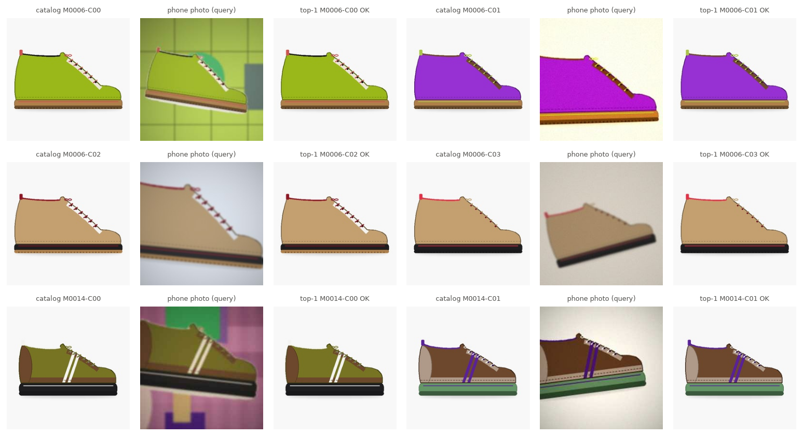
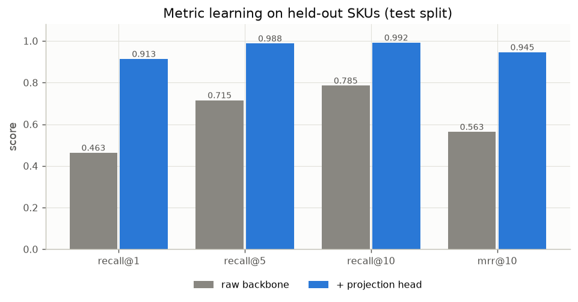
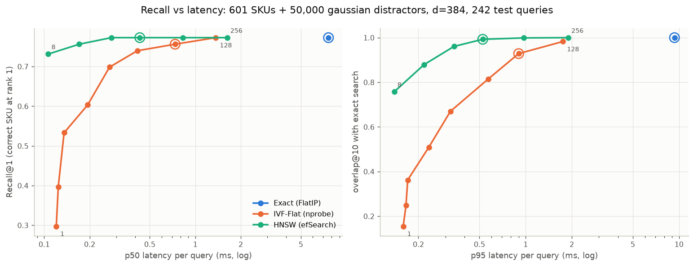

# Sneaker Sniper: Zero-Tag Visual Search & Metric Learning Engine

Find the catalog SKU of a sneaker from a **smartphone photo**, with no text tags, barcodes or
descriptions, only pixels. A frozen self-supervised backbone (**DINOv2 ViT-S/14** via `timm`)
turns images into L2-normalised embeddings. A light **metric-learning projection head**
(InfoNCE + hard-negative mining) makes them robust to phone-camera artefacts (white balance,
exposure, clutter, blur, JPEG). **FAISS** then serves them through three interchangeable indexes:
exact `IndexFlatIP`, `IndexIVFFlat` (Voronoi cells, `nprobe`) and `IndexHNSWFlat` (graph,
`efSearch`). The repo benchmarks the recall/latency trade-off (p50/p95), tracks every run in
**MLflow**, and ships a **Streamlit + Plotly** dashboard with a live smartphone-camera
simulator. Everything runs out of the box: a procedural sneaker catalog (Pillow) is generated on
first run, and the dashboard works even before training.



*Held-out test SKUs: clean catalog shot | simulated phone photo (query) | exact top-1 result
(projection-head space). Neighbouring tiles are sibling colourways of one model (same silhouette,
different colours). These siblings are the hard negatives that make the task difficult.*

---

## Key results

Run: `python train.py` (quick mode, default config), DINOv2 `vit_small_patch14_dinov2.lvd142m`
at 224 px, pretrained weights. Hardware: i7-12700H + RTX 3060 Laptop. Embeddings are computed
on the GPU; FAISS runs on the CPU with 4 OpenMP threads. Other jobs were sharing the machine,
so absolute latencies are pessimistic; the *ratios* are what matter.

**Data.** 150 sneaker models x 3-5 colourways = **601 SKUs** (1 studio image each) and
**1,202** simulated phone photos (2 per SKU). The split is **by model** (60/20/20): 359 train /
121 val / 121 test SKUs. All numbers below use the **242 test queries** (models never seen by
the head) against the **full** catalog.

### 1. Metric learning (exact search, 601-SKU catalog)

| backbone | embedding | Recall@1 | Recall@5 | Recall@10 | MRR@10 |
|---|---|---:|---:|---:|---:|
| DINOv2 ViT-S/14 (384-D) | raw (frozen) | 0.4628 | 0.7149 | 0.7851 | 0.5630 |
| DINOv2 ViT-S/14 (384-D) | **+ projection head** | **0.9132** | **0.9876** | **0.9917** | **0.9453** |
| ResNet-50 supervised (2048-D) | raw (frozen) | 0.3967 | 0.5455 | 0.6157 | 0.4633 |
| ResNet-50 supervised (2048-D) | + projection head | 0.5661 | 0.8223 | 0.8926 | 0.6753 |

ResNet-50 rows come from `python train.py --model resnet50 --artifacts-dir artifacts/resnet50`
(same data, split and head recipe). The self-supervised backbone is better raw (+6.6 pts
Recall@1), and much better after metric learning (+35 pts). Its features keep the instance
detail (colour, logo, panel layout) that the head can re-weight, while ImageNet-classification
features have already discarded part of it. Under the 50k-distractor stress test below, the gap
widens: exact-search Recall@1 is 0.244 for ResNet-50 + head (2048-D, 395 MB flat index, p50 17.7 ms)
vs 0.773 for DINOv2 + head (384-D, 74 MB, p50 7.6 ms).

The head is a residual MLP (384 -> 512 -> 384, zero-initialised output, so epoch 0 is exactly
the raw backbone). It trains in ~8 s on the CPU from cached features, using symmetric InfoNCE
(tau = 0.07) and 50% hard-negative batches. Early stopping on val Recall@1 picked epoch 41 and
stopped at epoch 56.



### 2. Recall vs latency at 50,601 vectors (601 SKUs + 50,000 synthetic distractors)

Head space, 384-D, batch size 1, 20 warm-up queries, each query replayed 3 times (726 timings per
setting). `overlap@10` is the agreement with exact search (label-free ANN quality).

| index | setting | Recall@1 | Recall@10 | overlap@10 | p50 (ms) | p95 (ms) | build (s) | memory (MB) |
|---|---|---:|---:|---:|---:|---:|---:|---:|
| Exact `IndexFlatIP` | - | 0.7727 | 0.9008 | 1.0000 | 7.62 | 9.34 | 0.03 | 74.1 |
| `IndexIVFFlat`, nlist = 900 | nprobe = 16 | 0.6983 | 0.7851 | 0.6698 | 0.27 | 0.32 | 2.74 | 75.8 |
| `IndexIVFFlat`, nlist = 900 | **nprobe = 64** | 0.7562 | 0.8802 | 0.9285 | 0.74 | 0.90 | 2.74 | 75.8 |
| `IndexIVFFlat`, nlist = 900 | nprobe = 128 | 0.7727 | 0.9050 | 0.9826 | 1.37 | 1.75 | 2.74 | 75.8 |
| `IndexHNSWFlat`, M = 32 | efSearch = 16 | 0.7562 | 0.8719 | 0.8789 | 0.17 | 0.22 | 19.43 | 87.3 |
| `IndexHNSWFlat`, M = 32 | efSearch = 32 | 0.7727 | 0.9008 | 0.9607 | 0.28 | 0.34 | 19.43 | 87.3 |
| `IndexHNSWFlat`, M = 32 | **efSearch = 64** | 0.7727 | 0.9008 | 0.9926 | 0.43 | 0.53 | 19.43 | 87.3 |

Bold rows are the default operating points. Takeaways:

* **HNSW dominates IVF** on this data: at efSearch = 64 it reproduces exact search (overlap 0.993,
  same Recall@1) **~18x faster** (p50 0.43 ms vs 7.62 ms). The price is a 7x longer build and
  +13 MB of graph links (2M x 4 bytes per vector at layer 0).
* **IVF needs a large nprobe** here: the Gaussian distractors fill the space evenly (no natural
  clusters), so neighbours often sit just across a Voronoi border. nprobe = 1 is fast (0.12 ms)
  but useless (overlap 0.16).
* **Distractors cost recall even for exact search** (0.913 -> 0.773 Recall@1): the 50k
  synthetic vectors behave like unseen products that sometimes outrank the true SKU. That is a
  property of the embedding, not of the ANN index (overlap stays ~1.0). On the 601-SKU catalog
  alone, all three indexes give the same 0.9132 Recall@1 (`artifacts/catalog_only_eval.csv`).
* Batching helps exact search a lot: 2.47 ms/query when all 242 queries go in one call
  (`batch_ms_per_query` in `benchmark.csv`).
* An ANN index can even score *higher* label recall than exact search: IVF at nprobe = 128 has
  Recall@10 0.905 vs 0.901, because it happened to skip a distractor that outranks the true SKU.
  That is why ANN quality is measured with overlap@K, not with recall.



> **Distractors are synthetic vectors, not images.** They are drawn from a Gaussian fitted
> (mean + covariance) to the real catalog embeddings, then L2-normalised, and they carry label
> `-1`, so any distractor in the top-K counts as a miss. Modes `random` (uniform on the sphere) and
> `perturbed` (fixed cosine to a real item) are available via `--distractor-mode`.

Run time of this quick run: 106 s with the synthetic data already cached (embedding 13 s,
training-view rendering + embedding 41 s, head 8 s, benchmark 38 s). A fresh clone also renders
the dataset (about 30-60 s) and downloads the 88 MB DINOv2 weights once.

---

## Architecture

```mermaid
flowchart LR
    R[render.py<br/>procedural sneakers] --> D[dataset.py<br/>catalog + queries]
    X[distortion.py<br/>phone-camera sim] --> D
    D --> E[embedder.py<br/>timm DINOv2, frozen<br/>L2-norm float32]
    X -->|training views| E
    E -->|raw features| M[metric_learning.py<br/>projection head<br/>InfoNCE + hard negatives]
    M -->|head space| I[indexer.py<br/>FlatIP / IVF / HNSW]
    E -->|raw space| I
    I --> V[evaluator.py<br/>Recall@K, MRR, overlap@K<br/>p50/p95, distractors]
    V --> A[(artifacts/ + MLflow)]
    A --> S[app.py<br/>Streamlit dashboard]
    I --> S
```

```
photo --> [phone-camera distortions] --> DINOv2 ViT-S/14 (frozen) --> 384-D --> L2 norm
      --> residual projection head --> L2 norm --> FAISS (Flat | IVF | HNSW) --> top-K SKUs
```

---

## Method

**Embeddings.** $z = f_\theta(x) \in \mathbb{R}^{384}$ is the CLS token of DINOv2 ViT-S/14. The input is
224 x 224 (16 x 16 patches of 14 px). The model is created with `img_size=224` so timm
interpolates the position embeddings; mean/std, interpolation and crop come from the model's own
`timm` data config. Every vector is L2-normalised, $\hat z = z/\lVert z\rVert_2$, so

$$\langle \hat a, \hat b\rangle = \cos(a,b), \qquad \lVert \hat a-\hat b\rVert_2^2 = 2-2\cos(a,b),$$

and ranking by inner product = by cosine = by Euclidean distance.

**Projection head.** $h(z) = \mathrm{norm}\big(z + W_2\,\mathrm{GELU}(W_1\,\mathrm{LN}(z))\big)$ with $W_2 = 0$ at
initialisation (identity map). Linear (PCA-initialised, for dimension reduction) and plain MLP
heads are available via `--head`.

**Loss.** Symmetric InfoNCE between phone-photo views $a_i$ and clean catalog images $p_i$ of the
same SKU, with in-batch negatives:

$$\mathcal{L} = -\frac{1}{2B}\sum_{i=1}^{B}\left[\log\frac{e^{\langle a_i,p_i\rangle/\tau}}{\sum_j e^{\langle a_i,p_j\rangle/\tau}} + \log\frac{e^{\langle a_i,p_i\rangle/\tau}}{\sum_j e^{\langle a_j,p_i\rangle/\tau}}\right]$$

Alternative (`--loss triplet`): batch-hard triplet loss
$\frac{1}{|A|}\sum_a[\max_{p} d(a,p) - \min_{n} d(a,n) + m]_+$ with $d(x,y) = \sqrt{2-2\langle x,y\rangle}$.

**Hard negatives.** At every epoch, each training SKU's nearest *other* SKUs in the current head
space are mined with an exact FAISS search. Half of every batch is built from a seed SKU plus its
neighbours, which in practice are mostly sibling colourways of the same model.

**Indexes.** Exact: $O(Nd)$ per query. IVF: spherical k-means into `nlist` ~ $4\sqrt{N}$ Voronoi
cells (capped at $N/39$), scanning the `nprobe` closest cells, cost $O(\text{nlist}\,d + \frac{\text{nprobe}}{\text{nlist}}Nd)$.
HNSW: a hierarchical proximity graph with `M` = 32 links per node and `efConstruction` = 200,
searched greedily with a candidate beam of width `efSearch`.

**Metrics.** Recall@K $=\frac{1}{|Q|}\sum_q \mathbb{1}[\text{rank}_q \le K]$; MRR@10 $=\frac{1}{|Q|}\sum_q 1/\text{rank}_q$;
overlap@K $=\frac{1}{|Q|}\sum_q |E_K(q)\cap A_K(q)|/K$ (exact vs ANN top-K agreement); latency
percentiles p50/p95 use linear interpolation over single-query timings after warm-up.

**Smartphone simulator** (`src/distortion.py`). Foreground mask (border-colour model +
`binary_fill_holes`), then perspective tilt and rotation fused into one homography, cluttered
background (wood / tiles / carpet + blurry objects), crop/zoom, white balance (luma-preserving RGB
gains), exposure in linear light ($x' = (2^{EV}x^{2.2})^{1/2.2}$), contrast, saturation, vignetting,
Gaussian blur, sensor noise, and JPEG re-encoding. The same function generates the benchmark
queries, the head's training views and the app's live sliders.

---

## Repository layout

```
sneaker-sniper/
  src/
    __init__.py         env defaults (KMP_DUPLICATE_LIB_OK, HF/MLflow noise)
    render.py           procedural sneaker renderer + catalog spec sampler (models x colourways)
    distortion.py       parameterised smartphone-camera distortion pipeline
    dataset.py          folder loader, synthetic bootstrap (cached), threaded views, group split
    embedder.py         timm feature extractor (data config, AMP, OOM retry, offline fallback)
    indexer.py          FaissIndex + Flat / IVF / HNSW builders, save/load, memory
    evaluator.py        Recall@K, MRR, overlap@K, p50/p95, distractors, benchmark sweeps
    metric_learning.py  projection head, InfoNCE, batch-hard triplet, hard-negative sampler
    search.py           SearchEngine used by the dashboard, artifact loading, stability profile
    plots.py            matplotlib (artifacts) + Plotly (dashboard) figures
    tracking.py         fail-safe MLflow wrapper (sqlite store inside the repo)
    utils.py            seeding, device/threads, logging, L2 normalisation
  tests/                62 offline tests (math, invariants, train + app smoke tests)
  docs/img/             figures used in this README (copied from artifacts/plots)
  train.py              end-to-end CLI pipeline
  app.py                Streamlit dashboard
  requirements.txt  pytest.ini  .gitignore  README.md
```

Generated at run time (git-ignored): `data/synthetic_<mode>/` (catalog + queries + metadata),
`artifacts/` (embeddings `.npy`, `.faiss` indexes, `benchmark.csv`, `metrics.json`, plots),
`mlflow.db` + `mlruns/`.

---

## Quickstart

```bash
python -m venv .venv
.venv\Scripts\activate            # Linux/macOS: source .venv/bin/activate
pip install -r requirements.txt

python train.py                   # quick mode: ~3-5 min on first run
streamlit run app.py              # works even before train.py (in-memory demo catalog)
pytest                            # offline, about 40 s

mlflow ui --backend-store-uri sqlite:///mlflow.db   # browse runs
```

Useful variants:

```bash
python train.py --mode full                        # ~2,000 SKUs, 200k distractors, 100 epochs
python train.py --model resnet50 --artifacts-dir artifacts/resnet50
python train.py --loss triplet --hard-negative-ratio 0
python train.py --distractors 200000 --distractor-mode random
python train.py --catalog-dir data/catalog --queries-dir data/queries   # your own photos
python train.py --no-pretrained --no-mlflow        # fully offline smoke run
```

**Your own catalog.** Put one folder per SKU, `data/catalog/<sku_id>/*.jpg`, with product shots
(a plain background helps the clutter simulation). Optional real phone photos go in
`data/queries/<sku_id>/*.jpg`; without them, queries are simulated. An optional
`data/metadata.csv` with `sku_id,model_id` enables leak-free group splits.

**Dashboard.** Pick a catalog SKU or upload a photo, then distort it with the sliders (rotation,
crop, exposure, blur, JPEG quality, colour temperature, perspective, noise, clutter). You see:
top-K from each index with images, *Self-Cosine Stability* (cosine between the clean and the
distorted embedding of the same image), *Exact vs ANN agreement* (overlap@K), the true SKU's
rank, a (K+1)x(K+1) pairwise cosine-distance heatmap, the recall/latency curves (from
`train.py` or a live mini-benchmark), a per-factor stability sweep and the metric-learning
results. Switching the backbone to ResNet-50 loads `artifacts/resnet50/` when it exists; artifacts
built with a different backbone, resolution or weights are never mixed with live embeddings.

---

## Design decisions & trade-offs

* **Frozen backbone + light head instead of full fine-tuning.** Catalog features are computed once,
  and the head trains in seconds with no risk of degrading DINOv2's general features. The ceiling
  is what the frozen backbone can see.
* **Zero-initialised residual head + early stopping on val**: training starts *exactly* at the
  backbone's quality and can only be kept if it improves on held-out models.
* **The head trains on the CPU** (`--head-device cpu`, the default). Features are cached and the
  MLP is tiny, so CUDA launch overhead outweighs the work. CPU training is also deterministic and
  leaves the shared GPU alone. During development, a GPU-trained head once died with a CUDA
  illegal-memory-access fault on the shared GPU.
* **Split by model, not by SKU**, so test shapes are never seen in training (no shape leakage
  through sibling colourways). The test split is evaluated once.
* **224 px input instead of DINOv2's default 518 px**: about 28x cheaper attention, enough detail
  for silhouettes. The resolution is stored in `artifacts/manifest.json`, and the app refuses
  artifacts built with a different backbone configuration.
* **Inner product on unit vectors** gives the same ranking as cosine or L2 and the simplest
  FAISS setup.
* **Synthetic distractors instead of downloading 50k images**: deterministic and offline, and
  they make latency differences measurable. They are clearly labelled as such.
* **Indexes are built and benchmarked one at a time**, so peak RAM stays at about 2 indexes
  (shared machine).
* **Thread pool (not processes) for rendering and distortion**: Windows multiprocessing is
  spawn-based, while PIL and numpy release the GIL in their heavy kernels, giving ~2.5x.
* **Fail-safe MLflow**: a tracking error is logged, never raised, and `artifacts/` is always written.

## Limitations

* **Synthetic domain.** Sneakers are procedural 2-D side views, and phone photos are simulated.
  Real photos add 3-D pose changes, occlusion, laces/creases and lighting that the simulator
  approximates only loosely. Expect lower absolute numbers on real data; the pipeline accepts
  real folders as-is.
* One reference image per SKU, side view only. No object detector/cropping before embedding.
* Latency numbers come from a shared laptop CPU (4 threads) and include Python call overhead
  (~10-20 us). Treat them as relative.
* Gaussian distractors approximate a larger catalog's density, not real products.
* `--mode full` (2,007 SKUs, 6,021 queries, 11,970 training views, 200k distractors) was run on
  the shared development machine through data generation, embedding and head training, but not
  timed end-to-end, because the machine was saturated by other jobs. The 200k-distractor benchmark
  adds ~0.7 GB on top of the ~1.1 GB pipeline footprint: the 310 MB matrix plus one index at a
  time.
* The dashboard mutates `nprobe`/`efSearch` on shared cached indexes, which is fine for a
  single-user demo but not thread-safe for concurrent users.

## References

* M. Oquab et al., *DINOv2: Learning Robust Visual Features without Supervision*, TMLR 2024, arXiv:2304.07193.
* K. He et al., *Deep Residual Learning for Image Recognition*, CVPR 2016.
* J. Johnson, M. Douze, H. Jegou, *Billion-scale similarity search with GPUs*, IEEE TBD 2019, arXiv:1702.08734; M. Douze et al., *The Faiss library*, arXiv:2401.08281.
* Yu. Malkov, D. Yashunin, *Efficient and robust approximate nearest neighbor search using Hierarchical Navigable Small World graphs*, IEEE TPAMI 2018, arXiv:1603.09320.
* H. Jegou, M. Douze, C. Schmid, *Product Quantization for Nearest Neighbor Search*, IEEE TPAMI 2011 (IVF).
* A. van den Oord, Y. Li, O. Vinyals, *Representation Learning with Contrastive Predictive Coding*, arXiv:1807.03748 (InfoNCE).
* T. Chen et al., *A Simple Framework for Contrastive Learning of Visual Representations (SimCLR)*, ICML 2020.
* A. Radford et al., *Learning Transferable Visual Models From Natural Language Supervision (CLIP)*, ICML 2021.
* F. Schroff, D. Kalenichenko, J. Philbin, *FaceNet*, CVPR 2015 (triplet loss).
* A. Hermans, L. Beyer, B. Leibe, *In Defense of the Triplet Loss for Person Re-Identification*, arXiv:1703.07737.
* R. Wightman, *PyTorch Image Models (timm)*, github.com/huggingface/pytorch-image-models.
